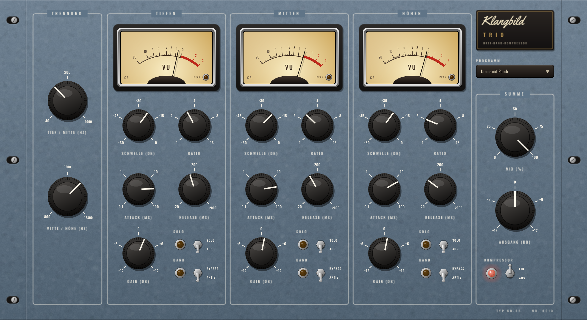

# Klangbild Trio

Drei-Band-Kompressor im Rack-Look – Tiefen, Mitten und Höhen werden getrennt komprimiert. So bändigst du
z. B. einen dröhnenden Bass, ohne dass der Gesang mitpumpt, oder zähmst scharfe Höhen, ohne den Rest
anzufassen. Audio Unit für Logic Pro (außerdem VST3 und Standalone), gebaut mit [JUCE](https://juce.com).



## Bedienung

| Bereich | Regler |
|---|---|
| **Trennung** | Tief/Mitte 40 … 1000 Hz · Mitte/Höhe 800 … 12 800 Hz |
| **je Band** | **Schwelle** (−60 … 0 dB) · **Ratio** (1:1 … 16:1, weiches Knie) · **Attack** (0,1 … 100 ms) · **Release** (20 … 2000 ms) · **Gain** (±12 dB) · **Solo** · **Bypass** · VU-Meter für die Reduktion |
| **Summe** | **Mix** (Parallelkompression) · **Ausgang** ±12 dB · **Kompressor Ein/Aus** (Bypass, bitgenau) |

Die VU-Zeiger stehen ohne Kompression auf 0 und wandern nach links, je stärker das Band zusammengedrückt wird.
Mit **Solo** hörst du ein Band allein – ideal, um die Trennfrequenzen einzustellen.

### Presets
Standard · Mastering sanft · Bass bändigen · Zischlaute zähmen · Gitarre glätten · Drums mit Punch · Gesang dicht

## Technik
- Frequenzweiche Linkwitz-Riley 4. Ordnung, phasenrichtig: ohne Kompression ergibt die Summe aller Bänder
  exakt wieder das Original (gemessen ±0,00 dB von 30 Hz bis 16 kHz)
- Mix arbeitet phasenrichtig (trockener Anteil läuft durch dieselbe Weiche) – keine Kammfilter
- Stereo verkoppelt je Band, keine Latenz

### Messwerte (48 kHz)
| Test | Ergebnis |
|---|---|
| Summe ohne Kompression, 30 Hz … 16 kHz | 0,00 dB |
| Solo-Bänder an den Trennfrequenzen | je −6,0 dB (Linkwitz-Riley) |
| Lauter Bass (60 Hz −6 dBFS) nur im Tiefenband komprimiert | Bass −18,7 dB leiser, 5-kHz-Ton daneben unverändert (±0,00 dB) |

## Installation in Logic Pro

Tab **Actions** → letzter grüner Lauf → **Artifacts** → `Klangbild-Trio-macOS`, dann:

1. `Klangbild-Trio-AU.zip` entpacken → `Klangbild Trio.component`
2. Finder → ⇧⌘G → `~/Library/Audio/Plug-Ins/Components` → Datei hineinkopieren
3. Einmal im Terminal:
   ```
   xattr -dr com.apple.quarantine ~/Library/Audio/Plug-Ins/Components/"Klangbild Trio.component"
   ```
4. Logic starten: **Audio Units → Klangbild → Klangbild Trio**

## Lizenzen

Schriften *Oswald* (OFL 1.1) und *Yellowtail* (Apache 2.0) – Lizenztexte in `Resources/`.
JUCE: AGPLv3 bzw. kommerziell – für den privaten Gebrauch unproblematisch.
